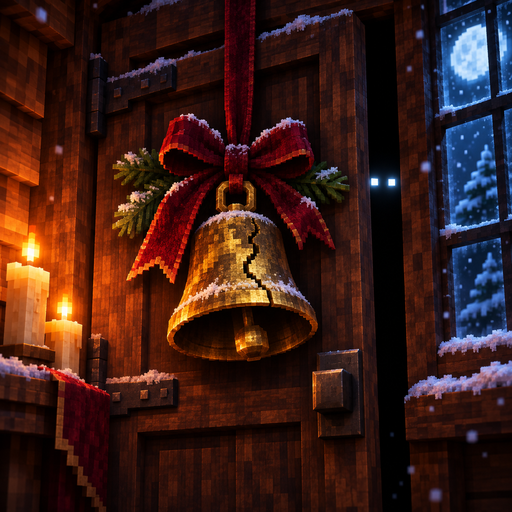
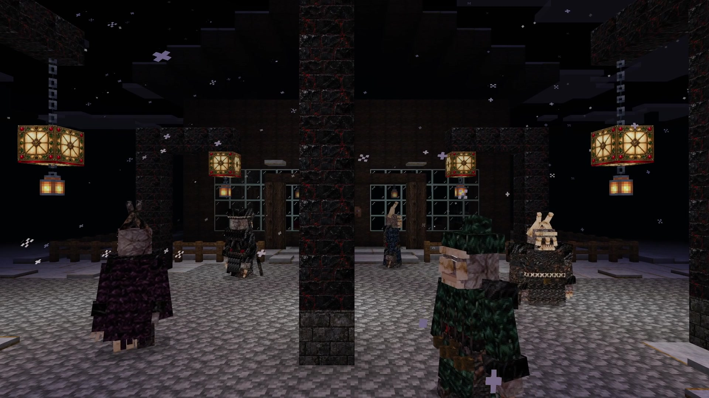
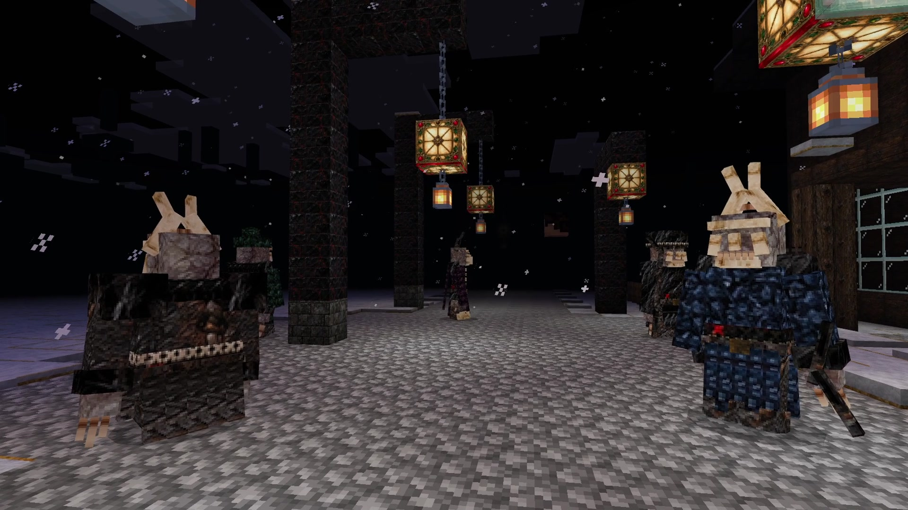
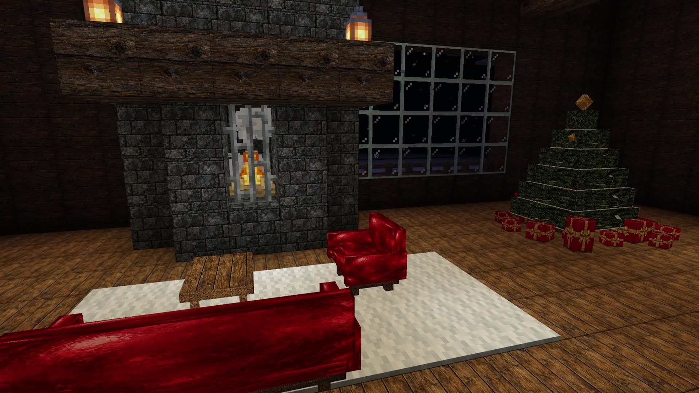
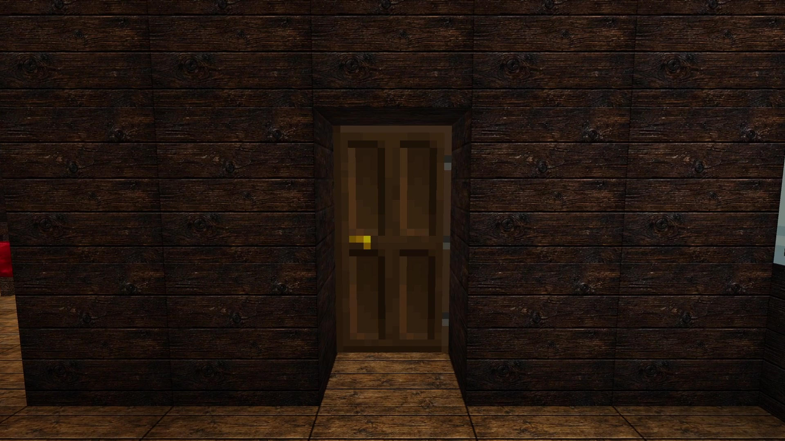
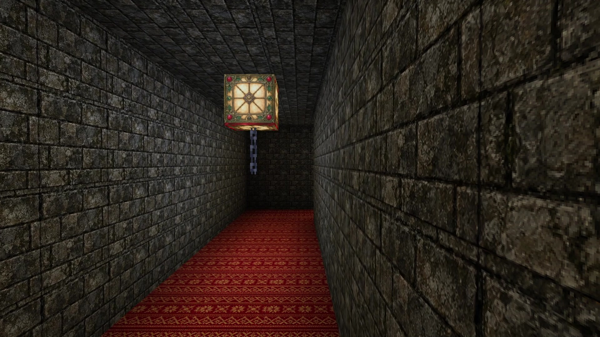

# Christmas Carol: The Last Song

## The singing outside is not the worst part.

Snow presses against the windows. The fire is warm. Somewhere out on the street, a Christmas carol begins.

You look outside.

Five figures stand beneath the lamps. Their eyes catch the light. Their song does not stop when you look away.

You could stay by the fire. You could pretend you heard nothing.

**But the most frightening thing this Christmas is not waiting outside your house. It is waiting beyond the pantry door.**

---

**Christmas Carol: The Last Song** is a complete single-player horror adventure for **Minecraft Bedrock**, built around a snowy Christmas night that refuses to feel safe.

Step into a furnished winter home, listen to an original Bulgarian-inspired male choir, and follow a story told through atmosphere, sound and the spaces around you. What comes next is yours to discover.

- A ready-to-play world: import, enter, and begin. No maze setup or command sequence.
- Original unsettling choral tracks that follow the danger, with smooth loops.
- Custom 3D characters, detailed environments and a carefully furnished Christmas home.
- Exploration, pursuit and combat, with a complete story to uncover.
- English on-screen text. Headphones strongly recommended.

**Keep the sound on. Keep your eyes on the door.**

## Play

[**Download the ready-to-play world**](https://github.com/sobata1995-source/Christmas-Carol/releases/latest/download/Christmas-Carol-1.4.18.mcworld)

Download **Christmas-Carol-1.4.18.mcworld** and open it with Minecraft Bedrock. Select the imported world and play. Its behavior and resource packs are included.

**Bedrock Edition only. Single player.** Tested by the creator and players on Minecraft for Windows. Mobile, console and Realms have not been verified. Built for Bedrock 1.21.120 or later with Script API 2.0.0. Keep music enabled so you can hear the original score.

Contains horror imagery, pursuit and sudden sounds. Recommended for players comfortable with horror experiences.

## A glimpse of the night

[Watch the spoiler-free trailer](https://github.com/sobata1995-source/Christmas-Carol/releases/download/v1.4.18/Christmas-Carol-Trailer.mp4)

## Support Razer Dev Studio

The adventure is free to download and play. Donations are entirely optional and support future maps, music and updates.

- **[Support on Patreon](https://www.patreon.com/c/denisaleksandrov/membership)**
- **[Leave a tip via Revolut](https://revolut.me/denisar2z)**
- **[Source, releases and bug reports on GitHub](https://github.com/sobata1995-source/Christmas-Carol)**

*One house. One Christmas night. One song you wish would end.*

## Build the world

Run `python tools/package_world.py`. The prepared world, scripts and resources are included. For the regression checks, run `node tests/test-house-loading.cjs`, `node tests/test-gift-rain.cjs`, `node tests/test-gift-corners.cjs`, and `node tests/test-final-pantry.cjs`.

Promotional icon: AI-generated artwork, not a gameplay screenshot. Gallery images and trailer footage are captured in Minecraft.
